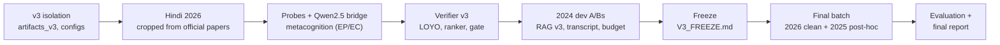

# Phase 3: v3 framework and the clean 2026 test

| | |
|---|---|
| **Branch** | `phase-3` (built on `phase-2`) |
| **Code** | Everything under `src/`, `configs/`, `scripts/` and `tests/` on this branch. v3 is additive: the v2 configs still reproduce the Phase-2 `results.json` exactly. |
| **Freeze** | [`V3_FREEZE.md`](../../V3_FREEZE.md), [`configs/v3_final.yaml`](../../configs/v3_final.yaml) |
| **Reports** | [`report/final_v3/final_report_v3.pdf`](../../report/final_v3/final_report_v3.pdf) (final report); [`report/FINAL_REPORT_v3.md`](../../report/FINAL_REPORT_v3.md) (Markdown version, all tables) |
| **Results** | [`results/v3/`](../../results/v3) |

---

## 1. Goals

These come from the Phase-2 limitations (`PHASE2.md` §4–5).

1. **A clean test set.** JEE Advanced 2026 came after the release of every model we use. 2025 was used to pilot v1/v2, and Qwen3-VL may have seen it.
2. **A pre-registered v3.** Each change is chosen on 2019–2024 only, by leave-one-year-out (LOYO) or on the 2024 dev year. Inclusion rules are fixed in advance, and the framework is frozen before any test run.
3. **Re-run the frozen v2 framework on 2026**, to check whether the v2 claims hold on clean data.
4. **A bridge to the paper:** run the framework with Qwen2.5-VL-7B, and report EP/EC in the paper's terms. Add memorisation probes.

## 2. Work done, in order

### 2.1 v3 changes (all frozen on 2019–2024)

| Component | Change | Evidence before the freeze |
|---|---|---|
| Adaptive budget | A cut-off answer continues once for 4,096 more tokens. Applies to every row, including the baselines. | 2024 dev, PoT: +2.3 [+1.0, +3.7] |
| Transcript block | The solver prompt also gets the VLM's own English transcription of the question (Hindi is translated). | 2024 dev: +4.9 [+1.8, +8.2]; no group significantly worse |
| RAG v3 | Hybrid tag + problem-text retrieval (w = 0.9); KB extended with JEEBench 2016–2018; τ tuned by LOYO | LOYO coverage 11.7% vs 8.4% for the v2 recipe, at the same proxy precision; 2024 accuracy ties v2 |
| Verifier v3 | XGBoost pairwise ranker with critic and pool features, trained on pools that contain corrected solutions, selected by LOYO | LOYO, 16-answer pools: 62.0 vs majority 53.7 (oracle 78.5) |
| Correction gate | Keep a corrected answer only if its verifier score rises by more than δ = −0.08 | Training: right→wrong 32 → 14, accuracy 47.6 → 48.2 |

### 2.2 Test sets

- **2026 (clean):** 204 questions. The 102 English questions come from the dataset. The 102 Hindi twins were cropped by `scripts/build_hindi2026.py` from the official Hindi papers, with automatic twin checks plus 14 crops checked by hand.
- **2025 (post-hoc):** the Phase-2 test set, reported only as post-hoc.

## 3. Results

### 3.1 2026 clean test (204 questions)

| Configuration | v2 framework (re-run) | v3 framework |
|---|---|---|
| Baseline CoT | 41.2 | 44.3 (with adaptive budget) |
| Self-consistency, matched compute | 49.0 | 52.5 |
| PoT solver | 43.0 | 49.8 |
| + Correction (cross-model critic) | 46.8 | 52.0 |
| **Full framework** | **55.4** [46.6, 63.7] | **58.8** [50.0, 67.2] |
| Framework vs matched SC | +6.4 [+1.5, +11.8], p = 0.015 | +6.4 [+1.5, +10.8], p = 0.011 |

- **The v2 claim holds on clean data.** Both frameworks beat compute-matched self-consistency.
- **v3 vs v2:** +3.4 [−1.5, +8.8], not significant. The v3 solver is better (PoT +6.8 [+3.6, +10.0]).
- **Verifier v3 on 2026** picks 58.8 vs 59.3 for majority vote over the same pool. Its advantage on 2025 (+6.3) does not carry over, and its features shift with the longer v3 solutions. The v3 gain on 2026 comes from the candidate pool.
- **Correction gate:** right→wrong 33 → 9, per-chain accuracy +0.6 (not significant).
- **Gaps that remain:** Hindi 53.9 vs English 63.7; diagram questions 30.3 vs text-only 72.5.

### 3.2 Other results

- **2025 (post-hoc):** v3 72.1 vs v2 65.3 (+6.8 [+1.1, +12.1]).
- **Qwen2.5-VL-7B bridge (2025 is clean for this model):** 14.0 → 15.3; framework vs SC −1.1. The framework needs a solver that is right often enough.
- **Memorisation probes:** answer-only accuracy is 10.5–15.7% on 2019–2024, 13.2% on 2025 and 15.2% on 2026, so there is no memorisation signal.

## 4. Issues encountered

| # | Issue | Cause | Fix |
|---|---|---|---|
| 1 | CUDA OOM in the v3 RAG stage | The embedder loaded on the GPU after vLLM had reserved memory | `MMJEE_EMBED_DEVICE=cpu` |
| 2 | `CUDA error: initialization error` at engine start | With a CPU embedder, vLLM forked its engine process | `VLLM_WORKER_MULTIPROC_METHOD=spawn` plus a `__main__` guard |
| 3 | Matched SC was sized with the wrong CoT run | `matched_samples` always used `cot` | Each SC row is matched against its own run |
| 4 | `--limit` smoke runs needed a subset KB | The KB directory got a `.limitN` suffix | `--limit` reads the full KB; `build-kb --limit` refuses to run |
| 5 | `--limit N` ignored the year filter | The subset was drawn before filtering | Filter first, then draw the subset |
| 6 | Three lab shutdowns during the final batch; one reboot loaded a kernel without the NVIDIA module | Shutdowns at the lab PC | NVIDIA module installed for the new kernel; resumed from the cache and chain checkpoints with identical results; backup PC prepared |
| 7 | Hindi crop errors (a section-header regex, stem headers, the paper end) | Layout of the official Hindi PDF | Regexes fixed; side-by-side checks |

## 5. Limitations

- One clean year: 204 questions, CIs of about ±8 points.
- We built the Hindi 2026 crops ourselves, in a different style from the dataset images.
- The verifier was not retrained for the v3 solution distribution.
- The transcript and the KB texts come from the same VLM; no external OCR is used.

## 6. Future enhancements

1. A selector that is robust to solution-length shift, retrained on v3-style pools.
2. Better perception for diagrams and Hindi; these gaps barely moved.
3. Fewer truncations: about 40% of PoT trajectories still end cut off.
