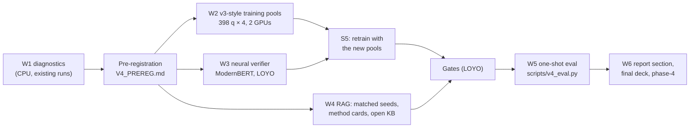

# Phase 4: final phase (post-hoc): selector under shift, neural verifier, RAG v4

| | |
|---|---|
| **Branch** | `phase-4` (built on `phase-3`) |
| **Code** | Additive on top of v3. The v2 and v3 configs still produce identical results, and Phase-4 outputs go to `artifacts_v4/` only. |
| **Pre-registration** | [`V4_PREREG.md`](../../V4_PREREG.md), written before any Phase-4 scoring on 2025/2026 |
| **Report** | [`report/final_v4/final_report_v4.pdf`](../../report/final_v4/final_report_v4.pdf): the v3 final report plus Sec. VII, "Post-hoc extensions (Phase 4)" |
| **Results** | [`results/v4/`](../../results/v4) |

**Status of the numbers.** The v3 framework stays frozen, and its clean 2026 result (58.8 vs 52.5 for matched SC) stays the headline. Both test years had been seen when Phase 4 started, so *every Phase-4 number on 2025 or 2026 is post-hoc*. All Phase-4 choices use 2019–2024 only: leave-one-year-out (LOYO) or the 2024 dev year.

---

## 1. Goals

These come from the Phase-3 limitations (`PHASE3.md` §5–6).

1. **Selection.** Find out why verifier v3 beat majority vote on 2025 (+6.3) but not on 2026 (−0.5), and try a fix: a selector without length features, a neural (DL) verifier, stacking, and training pools matched to the v3 solution distribution.
2. **Retrieval.** RAG fires on only about 16% of questions.
   - Measure its effect cleanly (matched seeds).
   - Try a different exemplar format (method cards).
   - Try a larger, open-licensed knowledge base.
3. **Use two GPUs** (two RTX 3060 PCs) without touching the frozen v2/v3 outputs.

## 2. Work done, in order

### 2.1 Components

| Component | Module / config | What it does |
|---|---|---|
| Training-pool subset | `pipeline/solve.py` (`subset_pairs`), `v4_pot_train_{a,b}`, `v4_train_corr_{a,b}` | v3-recipe PoT (transcript, adaptive budget, RAG) plus cross-model correction on a stratified subset of EN/HI twin pairs from 2019–2024 (398 questions). The parts `_a`/`_b` (years 2019–21 / 2022–24) share one subset and run on the two PCs. |
| Neural verifier | `verifier/neural.py`, CLI `train-neural-verifier` | Fine-tuned `answerdotai/ModernBERT-base` cross-encoder on (English transcript, answer, solution tail; 1,024 tokens). LOYO over 2019–2024, resumable per fold, plus a final model. |
| Selector variants | `verifier/v4.py`, CLI `train-verifier-v4` | `v3_ref` (the v3 ranker refit inside the same LOYO), `no_length`, `neural`, `stacked`. The gate is applied per pool kind. |
| Matched seeds | `rag.matched_seeds` (`configs/v4_rag_matched.yaml`) | RAG runs use the no-RAG seed namespace. Questions without exemplars give identical outputs. |
| Method cards | `rag/cards.py`, CLI `build-cards`, `rag.exemplar_format: card` | Each KB entry becomes a short card: method, when it applies, plan, key equations, common mistake. Answer strings are removed. |
| Open-licensed KB | `data/external.py` (`olympiadbench`), `configs/v4_kb.yaml`, `kb_open_pot` | 300 OlympiadBench items (Apache-2.0, pinned revision `91184b5`; English, text-only, numeric answers). Only verified-correct solutions enter `kb_v4`. |
| Evaluation | `scripts/v4_analysis.py` (W1), `scripts/v4_rag_sweep.py`, `scripts/v4_eval.py` (W5, run once), `scripts/final_report_v4.py` | Diagnostics, LOYO coverage, the one-shot test evaluation, and the report section. |
| Lab | `scripts/lab/launch_after.sh`, `seed_artifacts_v4.sh`, `supervise.sh`, `sync_to_lab.sh` | Queue a chain behind a running one; seed `artifacts_v4/` from v3; offline mode for a PC without Hugging Face access. |

**Gate** (fixed in `V4_PREREG.md`): a selector is scored on 2025/2026 only if its best LOYO pick accuracy beats the v3 ranker on every pool kind. Method cards are adopted only if card minus solution exemplars is > 0 *and* the paired-bootstrap lower bound is > 0.

## 3. Results

### 3.1 Diagnosis (W1, existing runs only)

| | 2025 | 2026 |
|---|---|---|
| Verifier v3 − majority (v3 pool) | +6.3 [+1.6, +11.1] | −0.5 [−2.9, +2.5] |
| Oracle | 87.4 | 79.4 |
| Mean tokens (training pools: 4.0k) | 7.3k | 8.3k |
| Standardised shift of log length vs training | 0.15 | 0.28 |

- **Length shift is small and similar in both years**, so it does not explain 2026. On 2026 the verifier loses on pools that are mostly finished (70.5 vs 75.2).
- **2026 errors** (204 questions): 120 correct, 42 selector misses, 42 never in the pool. In selector-miss pools only 17% of candidates are right.
- **Diagram questions:** 34.8% selector miss + 34.8% never in the pool. Text-only: 13.8% + 13.8%.

### 3.2 Selectors (LOYO on 2019–2024, no test data)

| Selector | v3 pools | + new pools: v3 | + new pools: new | Gate |
|---|---|---|---|---|
| v3 ranker (refit) | **62.0** | 61.2 | 59.5 | reference |
| S2: no length features | 59.1 | 61.6 | 60.1 | fail |
| S3: neural (ModernBERT) | 57.0 | 58.7 | 56.8 | fail |
| S4: ranker + neural score | 60.3 | 61.2 | 58.8 | fail |
| Majority / oracle | 53.7 / 78.5 | 53.7 / 78.5 | 55.8 / 71.6 | |

- **The neural verifier learns a real signal but stays below the ranker.** Candidate AUC is 0.787 (0.744–0.817 by year), and as a vote weight it beats majority. It still ranks worse than the handcrafted ranker.
- **The new pools don't help.** They add 3,184 candidates on 398 questions (half of them corrected). None of S2–S5 gains with them, and the refit v3 ranker itself moves 62.0 → 61.2, inside the ~1-point row-order noise of XGBRanker LOYO on 242 pools.
- **No selector passes its gate, so none is scored on test.** The one-shot `v4_eval.py` reproduces the frozen numbers: 2026 S0 58.8 vs majority 59.3; 2025 72.1 vs 65.8.

### 3.3 Retrieval

| | All questions | Where RAG fires |
|---|---|---|
| 2024 dev, matched seeds (204 q, RAG fires on 31): solution exemplars − no RAG | −0.25 [−1.0, +0.4] | −1.6 [−6.3, +2.5] |
| Method cards − no RAG | +0.3 [−0.2, +0.9] | +2.0 [−1.6, +6.3] |
| **Method cards − solution exemplars** | +0.55 [−0.1, +1.3] | **+3.6 [−0.8, +8.5]**, P(Δ≤0) = 0.07 |
| 2026 post-hoc PoT: kb_v4 − kb_v3 (retrieval changed on 12 q) | 0.0 [−0.4, +0.4] | 0.0 [−6.3, +7.3] (changed q) |

- **Matched seeds work.** The non-fired questions are identical across arms, so the RAG effect is now measured only where RAG fires.
- **Method cards are not adopted.** The trend is positive, but the lower CI bound is ≤ 0, and n = 31.
- **The open-licensed KB adds no coverage.**
  - kb_v4 has 813 entries: 451 mmJEE, 207 OlympiadBench and 155 JEEBench.
  - LOYO coverage at proxy precision 0.70 is 13.5% vs 15.0% for kb_v3.
  - OlympiadBench gives only 11 top hits, and its near neighbours raise the tuned τ (0.882 → 0.887).
- **Mixed RAG / no-RAG pools give no gain** (2026 majority vote: 52.5 vs 52.0 for 8 RAG samples).

**Takeaway.** Every Phase-4 extension is a well-measured negative or null result under rules fixed in advance. The 2026 selection gap is not length shift, and neither a stronger learned verifier nor matched training pools close it. Most remaining errors are perception failures on diagram questions, where the right answer is rare or absent in the pool.

## 4. Issues encountered

| # | Issue | Cause | Fix |
|---|---|---|---|
| 1 | Second lab PC had no Hugging Face access | Campus proxy | Model caches copied from the first PC; `supervise.sh` sets `HF_HUB_OFFLINE=1` when `~/saurav_mmjee/.hf_offline` exists |
| 2 | Copied model directories had no weights | HF cache stores files as dedup symlinks | Copy dereferenced (`rsync -aL`) |
| 3 | vLLM would not start on the second PC (`nvcc fatal: Unknown option '--compress-mode=size'`) | FlashInfer JIT-compiles the fp8-KV prefill kernel, and that PC's system CUDA is 12.0. Copying the JIT cache was not enough, because ninja's dependency log names the first PC's `/usr/local/cuda` headers. | The kernel compiled on the first PC (CUDA 12.6, same FlashInfer 0.6.18.post1, sm_86, identical paths) installed as an AOT artifact (`flashinfer/data/aot/<op>/<op>.so`), which FlashInfer loads without building |
| 4 | Queued chain did not start / would have run each token as a stage | `launch_after.sh` nested single-quoted args inside `bash -c '…'` | The waiter is written to `logs/<name>.waiter.sh`, checked with `bash -n` and run from there |
| 5 | LOYO of the refit v3 ranker gave 61.2 instead of 62.0 | XGBRanker depends on row order; new ranking-group keys reordered rows | v3 rows keep the bare uid as group key (reproduces 62.0); differences under ~1 point are treated as noise |
| 6 | Scientific-notation OlympiadBench answers could not be graded by the JEE scorer | Scorer expects plain numbers | Loader keeps plain decimals with abs ≥ 0.01 only |
| 7 | `--limit` smoke run picked questions outside the training subset | Subset applied after `--limit` | `select_questions(twin_keys=…)` filters first |

## 5. Limitations

- **Post-hoc:** all Phase-4 numbers on 2025/2026 are post-hoc. The gates kept every non-passing selector off the test years.
- **Small dev A/B:** only 31 dev questions fire RAG, so the method-card A/B has wide CIs.
- **Stacking estimate is slightly optimistic:** the neural feature for each training row comes from LOYO models that saw the stacking fold's held-out year (V4_PREREG §1).
- **One encoder size:** the neural verifier is ModernBERT-base on 1,024 tokens of each solution.

## 6. Future enhancements

1. **Perception.** Better perception for diagram questions, which would put the right answer into more pools. This is now the dominant error source.
2. **Larger dev sets for RAG.** Method cards need more fired questions to confirm or reject the +3.6 trend.
3. **Usefulness-trained retrieval and critic-guided retrieval.** Both are out of scope here (>100 GPU-h, noisy labels).
4. **Error cards and structured diagram queries.**
5. **Coaching / NCERT material.** This would need licences and leakage checks against 2025/2026.
