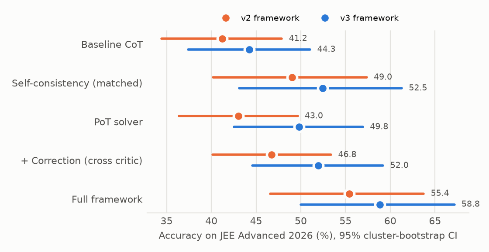

# mmJEE-Reasoner v3: final report

Team **Erdős**: Arpit Kumar (12340350), Saurav Gupta (12341940).

> Generated by `scripts/final_report_v3.py` from `artifacts_v3/` and the frozen v2 run in `artifacts/`.
> Every number below comes from the artifacts; none is typed by hand. Raw values: `report/final_v3/metrics.json`.

## Key findings

- **2026 (clean), v3 framework:** 58.8% (CI 50.0–67.2), vs baseline CoT 44.3% (+14.6 [+9.6, +19.5], significant gain). Vs self-consistency at matched compute (52.5%): +6.4 [+1.5, +10.8], significant gain.
- **2026 (clean), v2 framework:** 55.4% (CI 46.6–63.7), vs baseline CoT 41.2% (+14.2 [+9.0, +19.3], significant gain). Vs self-consistency at matched compute (49.0%): +6.4 [+1.5, +11.8], significant gain.
- **2025 (post-hoc), v3 framework:** 72.1% (CI 64.7–80.5), vs baseline CoT 48.3% (+23.8 [+17.4, +30.7], significant gain). Vs self-consistency at matched compute (58.4%): +13.7 [+6.3, +22.1], significant gain.
- **2026: v3 framework vs v2 framework:** +3.4 [-1.5, +8.8] points, no significant difference (McNemar p = 0.230).
- **2025 (post-hoc): v3 framework vs v2 framework:** +6.8 [+1.1, +12.1] points, significant gain (McNemar p = 0.024).
- **2026: v3 PoT vs v2 PoT:** +6.8 [+3.6, +10.0] points, significant gain (McNemar p = 0.000).
- **2026: gated vs ungated correction (v3):** +0.6 [-0.4, +1.5] points, no significant difference (McNemar p = 0.375).
- **Verifier vs majority vote over the same pool, 2026 v3:** 58.8 vs 59.3 (-0.5; oracle 79.4).
- **Verifier vs majority vote over the same pool, 2026 v2:** 55.4 vs 53.9 (+1.5; oracle 76.5).
- **Verifier vs majority vote over the same pool, 2025 v3:** 72.1 vs 65.8 (+6.3; oracle 87.4).

## 1. What changed from v2 to v3

v3 keeps the v2 architecture: a Qwen3-VL-8B (AWQ) solver writes program-of-thought solutions that run in a code sandbox, with a CoT fallback. An InternVL3.5-8B critic and the solver as corrector then run up to 3 correction rounds, and a learned verifier picks the final answer from the pool. v3 changes five things. Each was chosen on 2019–2024 data only and frozen before any test run (`V3_FREEZE.md`):

| Component | v2 | v3 |
|---|---|---|
| Token budget | 4,096 per call | A cut-off answer is continued once for 4,096 more tokens. This applies to every row, including the baselines. |
| Solver prompt | Image + exemplars | Also includes the question's English transcription (Hindi is translated) |
| RAG | Tag-only retrieval, 2019–2024 KB, τ tuned on 2024 | Hybrid tag + text retrieval (w = 0.9) over 2019–2024 plus JEEBench 2016–2018, with τ tuned leave-one-year-out |
| Verifier | XGBoost on all features, 8-sample pools | xgb_ranker / handcrafted / max_prob over 8 originals + 8 corrected, with pool-half and chain features |
| Correction acceptance | Always keep the corrected answer | Optional gate: keep the corrected answer only if the verifier score improves by more than δ = -0.08 |

### Dev evidence behind the freeze (2024 dev year)

| Arm (2024 dev, 204 questions) | Base | Arm | Δ [95% CI] | Rows changed |
|---|---|---|---|---|
| Transcript block (PoT) | 50.2 | 55.1 | +4.9 [+1.8, +8.2] | 1632 / 1632 |
| Adaptive budget (PoT) | 50.2 | 52.6 | +2.3 [+1.0, +3.7] | 453 / 1632 |
| Adaptive budget (CoT) | 48.5 | 54.9 | +6.4 [+2.5, +10.8] | 72 / 204 |
| RAG v2 recipe | 50.2 | 50.4 | +0.2 [-2.3, +2.9] | 1632 / 1632 |
| RAG v3 (hybrid + JEEBench) | 50.2 | 50.6 | +0.3 [-2.1, +3.0] | 1632 / 1632 |

The inclusion rule was fixed in advance: the gain must be > 0 and the paired-bootstrap lower bound must be > 0. The transcript block and the adaptive budget passed. RAG v3 ties RAG v2 on accuracy but covers more questions at the same precision (LOYO coverage 11.7% vs 8.4%), so it was kept.

Verifier v3 (LOYO 2019–2024, 16-answer pools): pick accuracy **62.0** vs majority 53.7 (oracle 78.5).

## 2. Clean test: JEE Advanced 2026 (204 questions = 102 EN + 102 HI)

The 2026 exam took place after Qwen3-VL was released, so this test set is clean. We built the Hindi crops from the official papers; their style differs from the dataset's images.

### 2.1 v3 framework

| Row | Overall | Numerical | 95% CI | vs baseline | Tokens / q | Calls / q |
|---|---|---|---|---|---|---|
| Baseline (single-pass CoT, adaptive budget) | **44.3** | 29.5 | 37.4–51.0 | – | 4.5k | 1.0 |
| Self-consistency (matched compute) (n = 18) | **52.5** | 34.6 | 43.1–61.3 | +8.2 [+4.5, +12.0] | 80.4k | 18.0 |
| + Code sandbox + RAG v3 + transcript (v3 PoT) | **49.8** | 37.3 | 42.5–56.9 | +5.6 [+2.0, +9.2] | 6.5k | 2.2 |
| + Learned verifier v3 (PoT pool only) | **57.8** | 41.0 | 48.5–66.2 | +13.6 [+8.4, +18.6] | 51.8k | 18.3 |
| + Correction (cross-model critic) | **52.0** | 39.6 | 44.6–59.2 | +7.7 [+4.3, +11.0] | 10.0k | 5.1 |
| + Correction (gated) | **52.6** | 39.9 | 44.9–60.1 | +8.3 [+4.7, +11.7] | 10.0k | 5.1 |
| v3 framework (verifier v3) | **58.8** | 44.9 | 50.0–67.2 | +14.6 [+9.6, +19.5] | 80.3k | 41.7 |

Framework vs matched self-consistency: **+6.4 [+1.5, +10.8]** points (cluster bootstrap), McNemar p = 0.011 (18 questions only the framework gets right, 5 only self-consistency).

### 2.2 The frozen v2 framework re-run on 2026

This is the v2 KB and verifier, with no v3 additions.

| Row | Overall | Numerical | 95% CI | vs baseline | Tokens / q | Calls / q |
|---|---|---|---|---|---|---|
| Baseline (single-pass CoT) | **41.2** | 26.5 | 34.4–47.9 | – | 2.9k | 1.0 |
| Self-consistency (matched compute) (n = 20; needs 21, capped) | **49.0** | 28.2 | 40.2–57.4 | +7.8 [+4.4, +11.3] | 58.0k | 20.0 |
| + Code sandbox | **43.0** | 31.1 | 36.4–49.6 | +1.8 [-1.1, +4.7] | 4.0k | 1.8 |
| + Agentic correction (cross-model critic) | **46.8** | 36.2 | 40.1–53.4 | +5.5 [+2.1, +9.0] | 7.4k | 4.7 |
| + Learned verifier | **55.4** | 39.7 | 46.6–63.7 | +14.2 [+9.0, +19.5] | 59.2k | 38.0 |
| Full framework | **55.4** | 39.7 | 46.6–63.7 | +14.2 [+9.0, +19.3] | 60.1k | 38.8 |

Framework vs matched self-consistency: **+6.4 [+1.5, +11.8]** points (cluster bootstrap), McNemar p = 0.015 (19 questions only the framework gets right, 6 only self-consistency).

### 2.3 Paired comparisons

All comparisons use a cluster bootstrap over EN/HI twin pairs. McNemar treats questions as independent, so its p-value is optimistic.

| Comparison | Δ points [95% CI] | P(Δ ≤ 0) | McNemar (a only / b only, p) |
|---|---|---|---|
| 2026: v3 framework vs v2 framework | +3.4 [-1.5, +8.8] | 0.113 | 16 / 9, p = 0.230 |
| 2026: v3 PoT vs v2 PoT | +6.8 [+3.6, +10.0] | 0.000 | 27 / 3, p = 0.000 |
| 2026: CoT adaptive budget vs CoT | +3.0 [+1.7, +4.5] | 0.000 | 6 / 3, p = 0.508 |
| 2026: gated vs ungated correction (v3) | +0.6 [-0.4, +1.5] | 0.122 | 4 / 1, p = 0.375 |
| 2026: verifier v3 pick vs v3 PoT mean | +9.0 [+5.8, +12.4] | 0.000 | 17 / 0, p = 0.000 |
| 2025 (post-hoc): v3 framework vs v2 framework | +6.8 [+1.1, +12.1] | 0.012 | 21 / 8, p = 0.024 |
| 2025 (post-hoc): v3 PoT vs v2 PoT | +8.1 [+4.8, +11.6] | 0.000 | 30 / 7, p = 0.000 |

## 3. 2025 (post-hoc)

> **Honesty statement.** 2025 was used to pilot v1/v2 (prompt, sampling and verifier decisions were checked on it), and Qwen3-VL may have seen the 2025 papers. 2025 numbers are therefore **post-hoc**. The clean claims rest on 2026 only. For Qwen2.5-VL (section 6), 2025 is clean.

| Row | Overall | Numerical | 95% CI | vs baseline | Tokens / q | Calls / q |
|---|---|---|---|---|---|---|
| Baseline (single-pass CoT, adaptive budget) | **48.3** | 43.2 | 41.7–55.3 | – | 4.0k | 1.0 |
| Self-consistency (matched compute) (n = 18) | **58.4** | 52.4 | 50.0–66.8 | +10.1 [+6.1, +14.1] | 72.4k | 18.0 |
| + Code sandbox + RAG v3 + transcript (v3 PoT) | **56.2** | 59.7 | 49.5–63.0 | +8.0 [+3.3, +13.1] | 5.9k | 2.3 |
| + Learned verifier v3 (PoT pool only) | **68.9** | 72.6 | 61.1–76.8 | +20.7 [+14.7, +27.3] | 47.3k | 19.5 |
| + Correction (cross-model critic) | **57.9** | 62.5 | 51.1–64.5 | +9.6 [+4.8, +15.0] | 8.7k | 5.0 |
| + Correction (gated) | **58.5** | 63.7 | 51.7–65.1 | +10.2 [+5.3, +15.6] | 8.7k | 5.0 |
| v3 framework (verifier v3) | **72.1** | 77.4 | 64.7–80.5 | +23.8 [+17.4, +30.7] | 69.9k | 41.1 |

Framework vs matched self-consistency: **+13.7 [+6.3, +22.1]** points (cluster bootstrap), McNemar p = 0.000 (37 questions only the framework gets right, 11 only self-consistency).

The v2 full framework on 2025 (frozen run, `artifacts/eval/results.json`) scored 65.3.

## 4. Where the framework wins and loses (full framework, accuracy %)

| Group | v2 fw 2026 | v3 fw 2026 | v2 fw 2025 | v3 fw 2025 |
|---|---|---|---|---|
| English | 60.8 | 63.7 | 73.7 | 74.7 |
| Hindi | 50.0 | 53.9 | 56.8 | 69.5 |
| Text only | 69.6 | 72.5 | 72.5 | 81.9 |
| Needs image | 25.8 | 30.3 | 46.2 | 46.2 |
| Physics | 32.4 | 35.3 | 54.8 | 64.5 |
| Chemistry | 52.9 | 60.3 | 60.9 | 59.4 |
| Mathematics | 80.9 | 80.9 | 79.7 | 92.2 |
| MCQ-Single | 79.2 | 83.3 | 67.4 | 65.2 |
| MCQ-Multiple | 55.6 | 55.6 | 59.5 | 69.0 |
| Numerical | 39.7 | 44.9 | 69.0 | 77.4 |
| Matching | 58.3 | 62.5 | 55.6 | 72.2 |

## 5. Correction loop and correction gate

### 5.1 Paper-style metacognition

These numbers follow base paper Sec. 4.2: EP is measured on originally wrong solutions and EC on detected ones. We also report false alarms and right→wrong flips, which the paper does not measure.

| Run | Chains | Acc. before → after | EP (detect) | EC r1 of detected | EP→EC final | False alarm | Wrong→right | Right→wrong |
|---|---|---|---|---|---|---|---|---|
| 2026 pot_corr_cross | 1632 | 43.0 → 46.8 | 67.5 | 9.7 | 8.2 | 23.6 | 76 | 15 |
| 2026 full | 1632 | 44.7 → 48.8 | 69.0 | 10.8 | 9.2 | 25.2 | 83 | 16 |
| 2026 v3_full | 1632 | 49.8 → 52.0 | 52.9 | 13.2 | 8.3 | 19.9 | 68 | 33 |
| 2025 v3_full | 1520 | 56.2 → 57.9 | 40.3 | 13.1 | 6.9 | 23.3 | 46 | 21 |
| 2025 pot_corr_cross (v2) | 1520 | 48.2 → 51.3 | 59.3 | 13.3 | 11.0 | 25.7 | 87 | 39 |
| 2025 full (v2) | 1520 | 50.9 → 54.7 | 60.7 | 15.7 | 11.7 | 28.6 | 87 | 29 |

### 5.2 Correction gate (verifier v3, δ = -0.08)

| Test set | Chains | Original | Corrected (ungated) | Gated | Accepted | Wrong→right (ungated → gated) | Right→wrong (ungated → gated) |
|---|---|---|---|---|---|---|---|
| Training, LOYO (selection of δ) | 1936 | 44.4 | 47.6 | **48.2** | 1809 | 95 → 88 | 32 → 14 |
| 2026 (clean) | 1632 | 49.8 | 52.0 | **52.6** | 1514 | 68 → 54 | 33 → 9 |
| 2025 (post-hoc) | 1520 | 56.2 | 57.9 | **58.5** | 1433 | 46 → 41 | 21 → 7 |

### 5.3 Verifier quality on the test pools

| Test pool | Primary verifier | AUC | Pick (max prob) | Weighted vote | Majority | Random | Oracle |
|---|---|---|---|---|---|---|---|
| 2026 v3 `v3_full` | xgb_ranker/handcrafted | 0.902 | **58.8** | 59.3 | 59.3 | 50.9 | 79.4 |
| 2026 v2fw `full` | logreg/all | 0.913 | **55.4** | 55.9 | 53.9 | 46.7 | 76.5 |
| 2025 v3 `v3_full` | xgb_ranker/handcrafted | 0.872 | **72.1** | 68.4 | 65.8 | 57.1 | 87.4 |
| 2025 v2 `full` | logreg/all | 0.836 | **65.3** | 66.8 | 65.8 | 52.8 | 85.3 |

### 5.4 Distribution shift for the verifier (limitation stated before the runs)

The verifier was trained on plain PoT solutions, without the transcript block or continuation. These are the length and fallback statistics its features depend on:

| Solutions | Rows | Accuracy | Cut off (`finish = length`) | CoT fallback | Tokens / sample | Acc. when cut off | Acc. when complete |
|---|---|---|---|---|---|---|---|
| train 2019-2024 pot_train | 10160 | 45.5 | 37.2 | 37.2 | 3506 | 28.9 | 55.3 |
| 2026 pot | 1632 | 43.0 | 42.8 | 43.2 | 3968 | 27.0 | 55.0 |
| 2026 v3_pot | 1632 | 49.8 | 40.3 | 40.2 | 6471 | 32.0 | 61.8 |
| 2025 pot | 1520 | 48.2 | 36.7 | 36.4 | 3511 | 29.9 | 58.7 |
| 2025 v3_pot | 1520 | 56.2 | 36.6 | 36.7 | 5915 | 41.7 | 64.7 |

## 6. Bridge: the paper's model (Qwen2.5-VL-7B) on 2025 (clean for that model)

| Row | Overall | Numerical | 95% CI | vs baseline | Tokens / q | Calls / q |
|---|---|---|---|---|---|---|
| Qwen2.5: Baseline (single-pass CoT) | **14.0** | 6.6 | 11.0–17.3 | – | 0.7k | 1.0 |
| Qwen2.5: Self-consistency (matched compute) (n = 20; needs 33, capped) | **16.3** | 10.7 | 10.0–23.2 | +2.3 [-1.9, +6.5] | 14.1k | 20.0 |
| Qwen2.5: + Code sandbox | **13.9** | 5.7 | 10.2–18.0 | -0.1 [-2.9, +2.9] | 1.0k | 3.6 |
| Qwen2.5: + Correction (same-model critic) | **13.9** | 6.1 | 10.2–17.9 | -0.1 [-2.9, +2.9] | 1.5k | 6.7 |
| Qwen2.5: + Correction (cross-model critic) | **13.7** | 8.0 | 10.3–17.3 | -0.3 [-2.9, +2.5] | 2.8k | 11.6 |
| Qwen2.5: + Learned verifier (transfer) | **15.3** | 8.3 | 10.0–21.1 | +1.3 [-3.3, +6.0] | 22.7k | 92.9 |

Framework vs matched self-consistency: **-1.1 [-7.4, +5.3]** points (cluster bootstrap), McNemar p = 0.860 (15 questions only the framework gets right, 17 only self-consistency).

## 7. Sampling headroom (pass@k)

| Run | pass@1 | pass@3 | pass@5 |
|---|---|---|---|
| 2026 cot | 41.2 | 57.2 | 63.9 |
| 2026 cot_ext | 44.3 | 60.0 | 66.7 |
| 2026 pot | 43.0 | 60.8 | 67.5 |
| 2026 pot_rag | 44.7 | 60.0 | 66.0 |
| 2026 v3_pot | 49.8 | 65.0 | 70.2 |
| 2025 cot_ext | 48.3 | 66.7 | 73.2 |
| 2025 v3_pot | 56.2 | 75.0 | 80.9 |
| 2025 cot (v2) | 43.2 | 62.6 | 69.7 |
| 2025 pot (v2) | 48.2 | 67.8 | 74.3 |
| 2025 pot_rag (v2) | 50.9 | 71.5 | 78.1 |

## 8. Memorisation probes

The probe asks for the answer only, with a 64-token limit (accuracy %). A model that had memorised a year would score clearly higher on it than on the clean year.

| Year | 2019 | 2020 | 2021 | 2022 | 2023 | 2024 | 2025 | 2026 |
|---|---|---|---|---|---|---|---|---|
| Qwen3-VL-8B | 12.5 | 14.6 | 11.8 | 10.5 | 14.5 | 15.7 | 13.2 | 15.2 |
| Qwen2.5-VL-7B | 12.5 | 12.3 | 14.5 | 17.1 | 13.5 | 14.2 | 12.1 | 21.1 |

## 9. Limitations

- **Verifier distribution shift.** See section 5.4. The verifier was not retrained, because no in-distribution training data exists without extra GPU time.
- **Shared transcriber.** The transcript block and the KB problem texts come from the same VLM; no external OCR is used.
- **Our Hindi crops.** For 2026 Hindi, results are reported per language (section 4).
- **One test year per claim.** With 204 clean questions, CIs are about ±7 points, so small differences are not significant.
- **Compute.** The framework spends many times the tokens of a single CoT pass. The fair comparison is self-consistency at matched compute, which is reported in every table.
